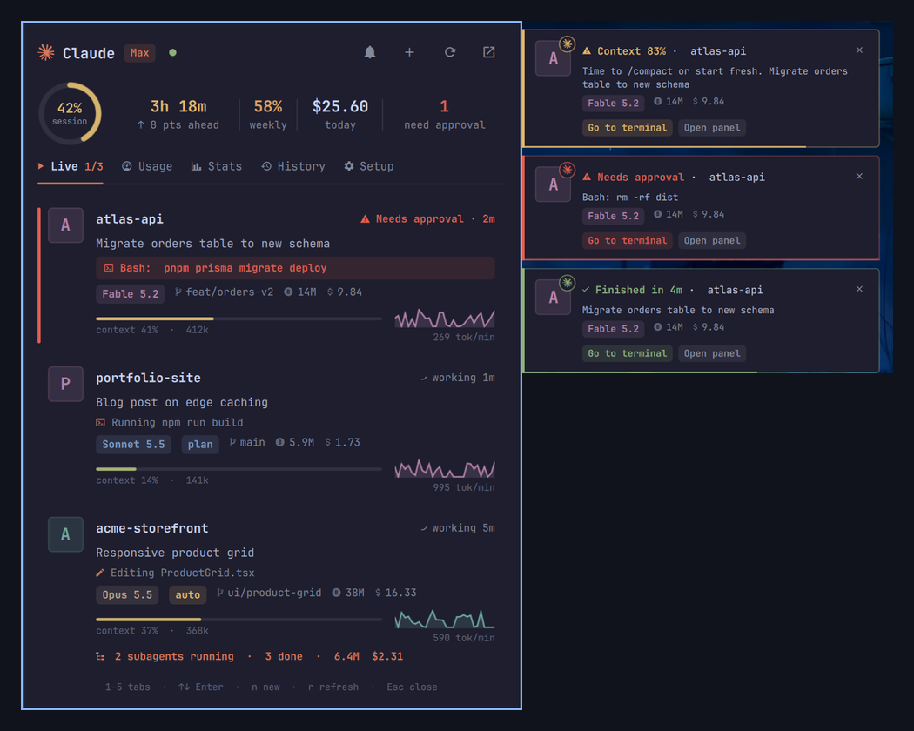
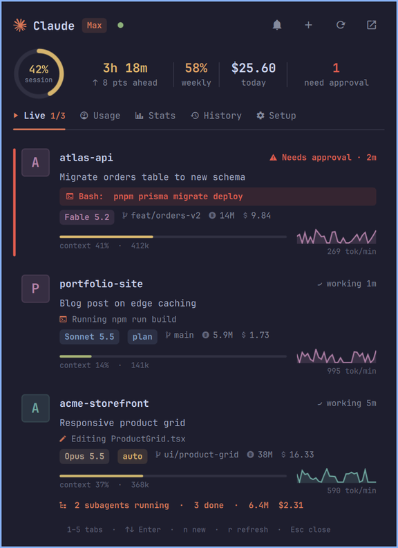
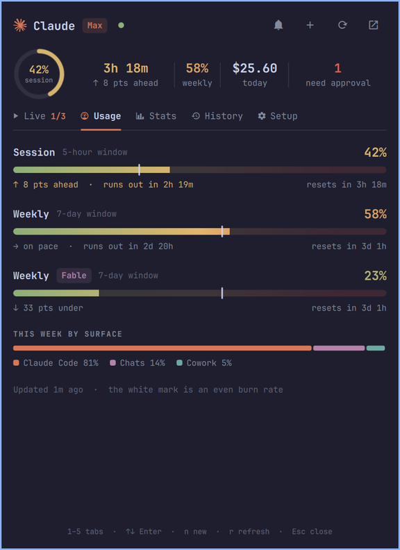
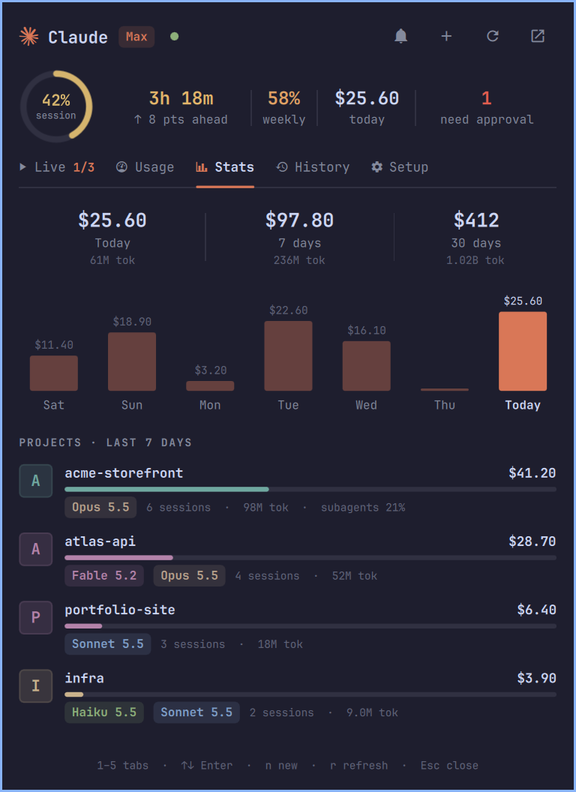
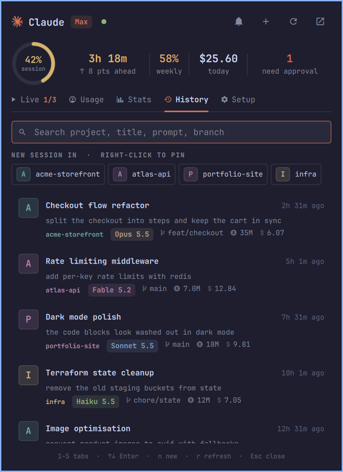
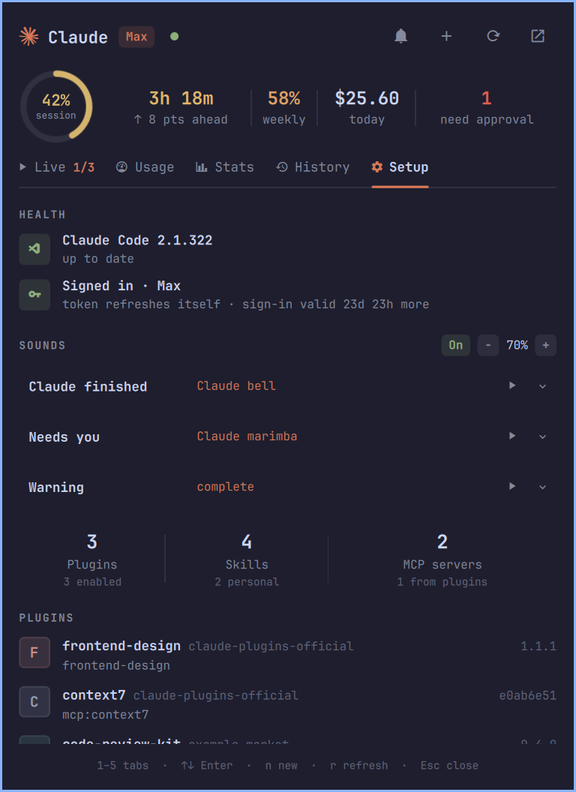
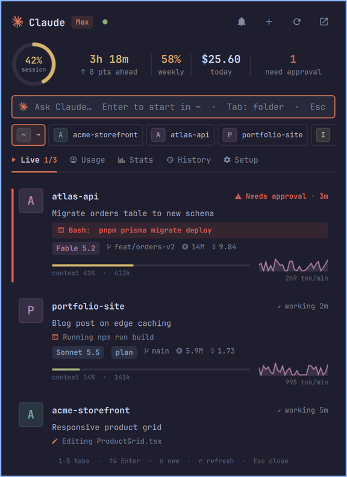
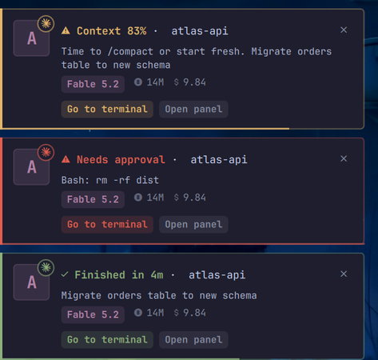
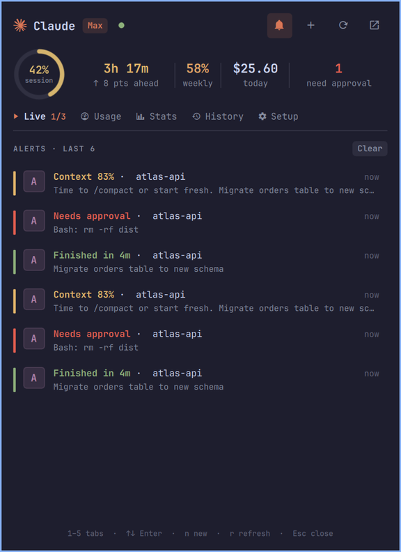
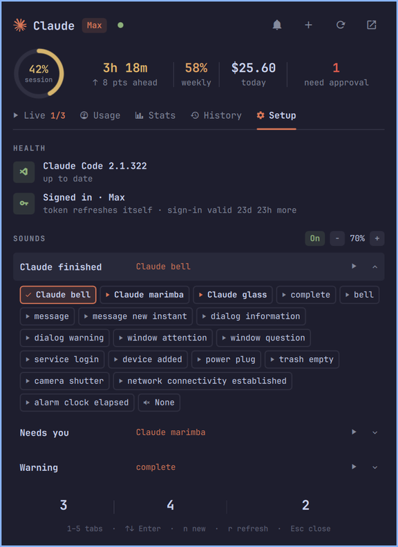

# Claude Pulse

**Claude Code, at a glance, in your [Omarchy](https://omarchy.org) bar.**

Claude Pulse puts everything about your Claude Code work in one place: how much of your plan you have used, every session that is running, what each one is doing right now, which one is waiting for you, what it all costs, and everything you ran this month. When Claude finishes a task or needs your answer, you hear its own tone and see a card, even when you are on another workspace.



<p align="center"></p>

> All screenshots use made-up projects and numbers (see [Screenshot mode](#screenshot-mode)).

## Contents

- [Install](#install)
- [The bar](#the-bar)
- [The panel](#the-panel)
  - [Summary strip](#summary-strip)
  - [Live](#live): running sessions
  - [Usage](#usage): plan limits and pace
  - [Stats](#stats): tokens and cost
  - [History](#history): search and resume
  - [Setup](#setup): health, sounds, plugins
- [Ask Claude: the launcher](#ask-claude-the-launcher)
- [Pinned projects](#pinned-projects)
- [Alerts](#alerts)
  - [Alert cards](#alert-cards)
  - [Alert log](#alert-log)
  - [Sounds](#sounds)
- [Keyboard and mouse](#keyboard-and-mouse)
- [Keybindings](#keybindings)
- [Command line (IPC)](#command-line-ipc)
- [Settings](#settings)
- [How it works](#how-it-works)
- [Privacy](#privacy)
- [Troubleshooting](#troubleshooting)
- [Screenshot mode](#screenshot-mode)
- [Development](#development)

## Install

```bash
omarchy plugin add https://github.com/iammhador/omarchy-claude-pulse.git --enable
```

That clones the plugin into `~/.config/omarchy/plugins/io.github.iammhador.claude-pulse` and adds the widget to your bar. If it does not appear, place it with `omarchy plugin enable io.github.iammhador.claude-pulse right`.

**Needs:** Omarchy 4 (Hyprland), Python 3 (standard library only), `pw-play` (PipeWire, for sounds), and [Claude Code](https://claude.com/claude-code). Plan limits need Claude Code signed in with a Pro or Max plan; everything else works without them.

Update later with `omarchy plugin update io.github.iammhador.claude-pulse`, remove with `omarchy plugin remove io.github.iammhador.claude-pulse`.

## The bar

| What you see | Meaning |
|---|---|
| The Claude mark | Coral normally; amber when the limit on the bar passes 75%, red past 90%. It **breathes** while Claude is working. |
| `42%` | Your 5-hour session limit (or weekly, see `barWindow`). |
| A coral badge, e.g. `1` | Sessions waiting for you. It turns **red** when one is blocked on an approval. |
| A small red dot on the mark | Another limit (weekly or a model) is at 90% or more, or status.claude.com reports an incident. |
| A shake and a ripple | A session just finished or needs you. |

Hover for a tooltip with the details. **Left click** opens the panel, **right click** jumps to the session that has waited longest, **middle click** refreshes everything.

## The panel

### Summary strip

Under the header, on every tab: a **ring** with your session %, then time to the reset with your **pace** (`↑ 12 pts ahead` means you are using it faster than time passes), your weekly %, today's spend, and how many sessions are waiting or **need approval**. Click any of them to jump to its tab.

The header holds your plan (Pro or Max), a **status dot** (green, or blinking red during a Claude incident, with details on hover and a banner below), and four buttons: the **alert log** bell, **Ask Claude** (the launcher), **refresh**, and your **usage page on claude.ai**.

### Live



Every Claude Code session running on this computer, the ones waiting for you first. Each row shows:

- **Project tile:** a letter in the project's own colour. The same colour is used in every tab, so a project is easy to spot.
- **Status:** `working 4m` (spinner) or `waiting 2m`. When Claude is blocked on you the row turns red: **Needs approval**, **Asking you a question**, **Plan ready to review** or **Needs your input**, with the tool and command (`Bash: pnpm prisma migrate deploy`) on a highlighted line.
- **Doing now:** what the session is doing this moment: `Running npm run build`, `Editing ProductGrid.tsx`, `Searching the web for …`.
- **Model tag** (Fable plum, Opus clay, Sonnet slate, Haiku sage), the **permission mode** (`plan`, `auto`, `accept edits`, or `bypass` in red), the git **branch**, and **tokens** and estimated **cost** for the session, subagents included.
- **Context bar:** how full the context window is. Past 80% it turns red and says `time to /compact`.
- **Activity sparkline:** output tokens per minute over the last 30 minutes, with the current rate.
- **Subagents:** how many are running and done, their tokens and cost, and what each running one is doing.
- An **old version** flag when a session runs an older Claude Code than the one installed.

**Click a row** (or select it and press Enter) to jump to its terminal. **Hover** for actions: copy session ID, open the folder, open in your editor, pin the project, start a new session here, go to the terminal.

Below the sessions, **Background jobs** (from `claude --bg` and scheduled runs) show their state (working, blocked, done, failed), what they need, and their tokens. Click one to resume it.

### Usage



Your plan limits, straight from Claude: the **5-hour session**, the **weekly** limit, and any **per-model** weekly limit (for example Fable).

Each meter is a thermometer from sage through amber to red. The **white mark** is where an even burn rate would be; if the fill is past it you are ahead of pace. Under each meter are the pace (`↑ 21 pts ahead · runs out in 1h 53m`) and the countdown to the reset. Weekly meters also show a **daily allowance** (`≈15% a day keeps you within this limit`): what is left, spread evenly over the days until the reset.

Below: **this week by surface** (Claude Code, chats, Cowork) and your extra-usage credit if you have it. The footer says when the data was fetched; it refreshes every 5 minutes, because the endpoint is rate-limited.

### Stats



Read from your local transcripts:

- **Today, 7 days, 30 days:** estimated cost and tokens.
- **A 7-day chart**, today in coral. Hover a bar to highlight it.
- **Projects (last 7 days):** cost and tokens, models used, sessions, and the share spent by subagents.
- **Models (last 7 days):** tokens, cost and replies per model.

Costs are **API-equivalent estimates** (list prices, cache reads and writes included). A subscription bills a flat fee, so read them as "what this would cost on the API". Turn them off with `costEstimates`.

### History



- **Search** every session from the last 30 days by project, title, prompt, branch or model. Every word you type must match.
- **Click a session** (or press Enter) to **resume** it with `claude --resume` in a new terminal, in its own folder. Hover for copy ID and open folder.
- **New session in:** your pinned and recent folders. Click one to open the launcher there; **right-click** to pin or unpin it.

### Setup



**Health**

- **Claude Code version**, with an **Update** button when a newer one is out (it opens a terminal running `claude update`).
- **Sign-in:** your plan and how long your sign-in stays valid. Amber under three days, red when expired.
- **MCP servers that need you to sign in again**, in red, with how to fix it (`/mcp`).

**Sounds:** choose and preview the tones (see [Sounds](#sounds)).

**Plugins, skills and MCP servers:** every Claude Code plugin you have installed (with its skills, commands, agents and MCP servers, and whether it is enabled), your personal skills in `~/.claude/skills`, and your MCP servers. Read-only.

A coral dot on the Setup tab means something in Health needs attention.

## Ask Claude: the launcher



Press **`n`** in the panel, click the **`+`** button, or run `omarchy-shell claude-pulse launch`.

1. Type what you want Claude to do.
2. Pick the folder: **Tab** / **Shift+Tab** cycles through `~`, your pinned projects, then recent ones. The chosen one is outlined in coral. Clicking a folder works too.
3. Press **Enter**: a terminal opens in that folder running `claude` with your prompt. Leave the prompt empty to just start Claude there.

**Esc** closes the launcher. It starts in the selected session's folder, else your first pin, else your home.

## Pinned projects

Pin the projects you work on most, so they come first in the launcher and in History.

- **Pin:** hover a session in Live and click the pin, or **right-click** a folder in the launcher or History.
- **Unpin:** the same again.

Pins are kept in `~/.local/state/claude-pulse/pins.json` and survive restarts.

## Alerts

| Alert | When | Sound | Card |
|---|---|---|---|
| **Finished** | A run of 2 minutes or more ended | Finished tune | Sage, 8 s |
| **Needs approval / your input** | Claude shows a permission prompt or a dialog | Needs-you | Red, stays |
| **Asking you a question** | Claude asks you a question | Needs-you | Coral, stays |
| **Plan ready** | A plan waits for your review | Needs-you | Coral, stays |
| **Waiting for you** | A short turn ended (after `waitingDelaySec`) | Needs-you | Coral, 8 s |
| **Context 80%** | A session's context passed `contextWarnPct` | Warning | Amber, 8 s |
| **Background job** | A job finished, or got blocked or failed | Finished / Warning | Sage / red |
| **Limit** | A limit passed 75% or 90%, or reset | Warning at 90% | Amber / red / sage |
| **MCP / sign-in** | An MCP server needs sign-in; your sign-in ends within 3 days | Warning | Red / amber |

For the terminal you are looking at, only the sound plays; no card pops up over your work.

### Alert cards



Claude Pulse shows its own cards, top right under the bar, in the panel's style. Each card has:

- the **project tile**, with the Claude mark pulsing in the alert's colour (sage finished, coral needs you, red blocked, amber warning),
- what happened, and the session title or the exact command waiting for approval,
- the model, tokens and cost,
- buttons: **Go to terminal** (or **Answer**, **Review**, or **Resume** for a job) and **Open panel**, plus **✕** to dismiss.

Cards slide in and stack, four at most. Normal ones hide after 8 seconds, shown by a countdown line; **hovering pauses** them. Approvals and questions **stay until you deal with them**, and clear themselves once the session moves on. Clicks pass straight through the space around the cards.

### Alert log



Every alert is also kept in Claude Pulse's own log: the last 50, in `~/.local/state/claude-pulse/alerts.json`. The **bell** in the panel header shows the unread count. Click it to see the log; opening it marks everything read. Click an entry to act on it again; **Clear** empties the log.

Omarchy's notification centre can't store a notification without also showing its own pop-up, so Claude Pulse keeps its own log instead of sending system notifications.

### Sounds



Claude Pulse has its own tones, composed for it, so they don't sound like any other app:

| Event | The tone |
|---|---|
| **Claude finished** | A warm three-note rising chime: done. |
| **Needs you** | Two quick notes: your turn. |
| **Warning** | Two soft notes falling: careful. |

They come in three sets: **Claude bell** (the default), **Claude marimba** (woody, short) and **Claude glass** (bright, airy).

**To choose:** open **Setup → Sounds**, or run `omarchy-shell claude-pulse sounds finished`.

- Each event shows its current sound with a **▶** button to hear it.
- Click the row to open the list: the three Claude sets, fifteen system sounds, and **None**.
- **Click any sound to hear it and choose it.** It is saved at once.
- **On / Off** and the **volume** (− and +) are in the same section.

The finished tune plays even when you are looking at that terminal, so you always hear when Claude is done.

## Keyboard and mouse

In the panel:

| Key | Action |
|---|---|
| `1` – `5`, Tab, Shift+Tab | Switch tabs |
| `↑` `↓`, Enter | Pick a session (jump to it) or a past session (resume it) |
| `n` | Ask Claude (the launcher) |
| `r` | Refresh everything |
| `/` | Search history |
| Esc | Clear the search or selection, then close |

On the bar: **left click** opens the panel, **right click** jumps to the longest-waiting session, **middle click** refreshes.

## Keybindings

Add these to `~/.config/hypr/bindings.lua`:

```lua
o.bind("SUPER + ALT + C", "Claude Pulse", "omarchy-shell claude-pulse toggle")
o.bind("SUPER + ALT + J", "Next Claude session waiting", "omarchy-shell claude-pulse cycleWaiting")
```

**SUPER+ALT+J** jumps to the next session waiting for you, round-robin, without opening the panel. Press it again for the next one.

## Command line (IPC)

```bash
omarchy-shell claude-pulse toggle                # open or close the panel (also: open, close)
omarchy-shell claude-pulse openTab usage         # live, usage, stats, history, setup
omarchy-shell claude-pulse launch                # the Ask Claude launcher
omarchy-shell claude-pulse focusWaiting          # jump to the longest-waiting session
omarchy-shell claude-pulse cycleWaiting          # next waiting session, round-robin
omarchy-shell claude-pulse refresh               # fetch everything now
omarchy-shell claude-pulse status                # plain-text summary, one line per session
omarchy-shell claude-pulse waitingCount          # a number, for scripts
omarchy-shell claude-pulse alerts                # open the alert log
omarchy-shell claude-pulse sounds needs          # open the sound picker (finished, needs, warning)
omarchy-shell claude-pulse testSound finished    # play a tone (finished, needs, warning)
omarchy-shell claude-pulse testAlert approval    # sample card: finished, approval, question, plan, context, jobdone, limit
omarchy-shell claude-pulse dismissCards          # clear the cards on screen
omarchy-shell claude-pulse clearAlerts           # empty the alert log
```

## Settings

Change them in the shell settings, with `omarchy bar set io.github.iammhador.claude-pulse <key> <value>`, or in the widget's entry in `~/.config/omarchy/shell.json`. The sound picker writes the sound settings for you.

| Key | Default | Meaning |
|---|---|---|
| `colorScheme` | `claude` | `claude`: Claude's coral accent and warm gauge, model and project colours, on your theme's background. `theme`: your theme's accent colours too |
| `barWindow` | `session` | Limit on the bar: `session` or `weekly` |
| `showPercent` | `true` | Percentage next to the mark |
| `showWaitingCount` | `true` | Badge with the sessions waiting for you |
| `pulse` | `true` | Shake the mark when a session finishes or needs you |
| `colorBar` | `true` | Colour the mark by usage |
| `contextual` | `false` | Hide the widget while no session runs |
| `pollMs` | `1500` | How often sessions are checked (ms) |
| `usageIntervalSec` | `300` | How often plan usage is fetched (300 minimum) |
| `alertWaiting` | `true` | Cards when a session finishes or needs you |
| `waitingDelaySec` | `10` | How long a session must wait before "Waiting for you" |
| `finishedAfterSec` | `120` | A run this long counts as a finished task |
| `alertLimits` | `true` | Alerts at 75% / 90% of a limit and on reset |
| `alertContext` | `true` | Alert when context is nearly full |
| `contextWarnPct` | `80` | The context threshold |
| `alertJobs` | `true` | Alerts for background jobs |
| `statusCheck` | `true` | Check status.claude.com |
| `costEstimates` | `true` | Show cost estimates |
| `sounds` | `true` | Play sounds |
| `soundFinished` | `claude` | `claude`, `claude-marimba`, `claude-glass`, a name from `/usr/share/sounds/freedesktop/stereo`, a file path, or `none` |
| `soundNeedsYou` | `claude` | Same choices |
| `soundWarning` | `claude` | Same choices |
| `soundVolume` | `70` | 0–100 |
| `editor` | `auto` | For "open in editor": `auto` (Omarchy's default editor), `code`, `zed` or `nvim` |

## How it works

The widget (`BarWidget.qml`) runs a small Python helper, `bin/claude-pulse-helper`, and draws what it returns. Pure logic lives in `Model.js`.

- **Sessions:** Claude Code keeps a registry file for each running session in `~/.claude/sessions/`. Its status tells busy, finished (`idle`) and **waiting** (a permission, question or plan dialog is on screen). Model, tokens, context, title, prompt, branch, permission mode and the current tool call come from each session's transcript in `~/.claude/projects/`; subagents come from its `subagents/` folder. Windows are found by walking up from the session's process to the terminal Hyprland knows.
- **Stats and history** read the last 30 days of transcripts. The helper remembers how far it has read in each file (in `~/.cache/claude-pulse/`), so after the first scan it reads only new lines, in about 40 ms.
- **Usage** calls `api.anthropic.com/api/oauth/usage` with the token Claude Code stores, at most every 5 minutes, and honours `Retry-After`. It **never refreshes or rewrites that token**, so it cannot sign your CLI out; if the token is stale, open `claude` once.
- **Background jobs** come from `~/.claude/jobs/*/state.json`. **Health** comes from your credentials' expiry dates (the token itself is never read out) and `~/.claude/mcp-needs-auth-cache.json`. The **version** comes from `claude --version` and the npm registry.
- **Status** reads `status.claude.com/api/v2/summary.json` every 5 minutes.
- **Sounds** are WAV files built by `tools/make-sounds.py` and played with `pw-play`.

The session registry, transcripts, jobs and usage endpoint are internal to Claude Code, not a documented API. If an update changes them, a tab may go empty until the plugin is updated; please open an issue.

## Privacy

Everything stays on your computer. Claude Pulse makes only three kinds of request: the usage endpoint (to Anthropic, with your own token), status.claude.com, and the npm registry for the latest Claude Code version. It writes only to its own folders, `~/.cache/claude-pulse/` and `~/.local/state/claude-pulse/` (pins and the alert log). It never changes Claude Code's files.

## Troubleshooting

| Problem | Fix |
|---|---|
| The Usage tab says *token expired* | Open `claude` once; it refreshes its own sign-in. |
| *rate limited* | The usage endpoint allows only a few requests an hour. The panel shows when it will try again. |
| A session doesn't jump to its terminal | The terminal must be a normal window Hyprland knows; tmux and remote shells can't be found. |
| No sound | Check that Setup → Sounds is **On** and the volume is up; run `omarchy-shell claude-pulse testSound finished`; make sure `pw-play` is installed. |
| Changes to the plugin files don't show | Run `omarchy restart shell`. |
| Cards appear on the wrong monitor | They follow the focused monitor; focus the one you want. |

## Screenshot mode

`python3 tools/make-demo.py` writes `~/.cache/claude-pulse/demo.json`. While that file exists, every helper command answers with its made-up data (three invented projects, with usage, stats, history and jobs). Delete the file to see your own data again. The screenshots here were made that way.

## Development

```bash
node tests/model.test.js                     # Model.js
python3 -m unittest discover -s tests        # helper and sounds
python3 tools/make-sounds.py                 # rebuild assets/sounds
omarchy restart shell                        # after editing QML
```

## Credits

Inspired by [claudebar](https://github.com/mryll/claudebar) (plan usage) and [omarchy-claude-sessions](https://github.com/Edward-Kulyk/omarchy-claude-sessions) (live sessions). Not affiliated with Anthropic.

## License

[MIT](LICENSE)
